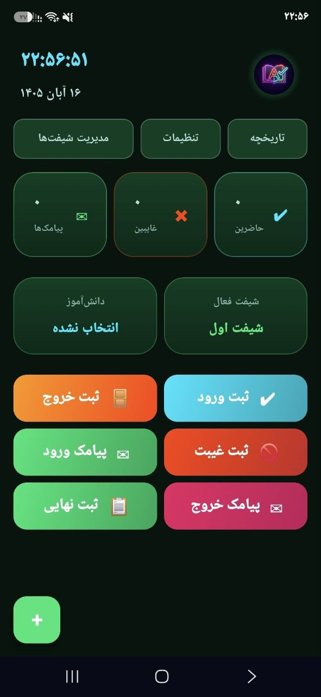
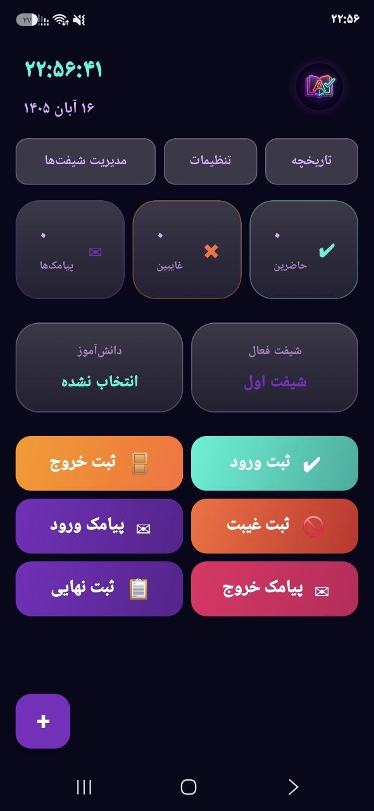
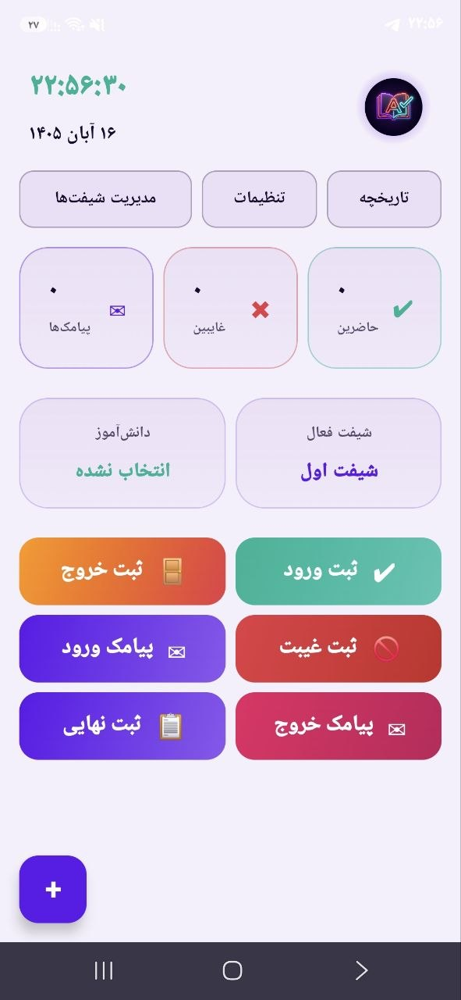

<div align="center">

<!-- 🖼️ لوگوی پروژه -->


# 📚 آمادینو | Amadino
**سیستم هوشمند مدیریت حضور و غیاب و ارسال پیامک خودکار | Smart Attendance & Automated SMS System**

[](https://developer.android.com)
[](https://kotlinlang.org)
[](https://developer.android.com/jetpack/compose)
[]()
[](https://opensource.org/licenses/MIT)

### 🌐 انتخاب زبان | Choose Language
**[🇬🇧 English Version](#-english-version)** | **[🇮🇷 نسخه فارسی](#-نسخه-فارسی)**

</div>

---

<div dir="ltr" id="english-version">

## 🇬🇧 English Version

### 🌟 About The Project
**Amadino** is a native, **Offline-First** Android application designed to simplify the management of small and medium educational institutes. Unlike many similar apps, Amadino stores all student data, attendance records, and settings locally on the device with high security. No servers, no internet required. Built with modern Android technologies and focusing on **Glassmorphism UI** and a seamless user experience.

### ✨ Features
- **🎨 Dynamic UI/UX:** Supports 3 beautiful themes (Cyber Violet, Solar Dawn, Emerald Matrix) with Glassmorphism effects.
- **📋 Smart Attendance:** Record check-in, check-out, and absences independently per class shift.
- **✉️ Automated SMS:** Dynamically generated SMS templates for parents with variables like `{name}`, `{date}`, and `{time}`.
- **📊 Data & Reports:** Secure local JSON storage, History logs, and Excel (CSV) export.
- **🌍 RTL Support:** Fully optimized for Persian (Farsi) language, featuring the Jalali calendar and Persian digits.

### 🛠️ Tech Stack
- **Language:** Kotlin
- **UI Framework:** Jetpack Compose (Material 3)
- **Architecture:** MVVM (Model-View-ViewModel)
- **Async Processing:** Kotlin Coroutines & StateFlow
- **Local Database:** JSON File (with Atomic Writes & Mutex Locks)
- **SMS API:** Android `SmsManager`

### 🚀 Installation
1. Clone the repository:
   ```bash
   git clone https://github.com/Amirh2006/Amadino.git
Open the project in Android Studio.

Build and install on your connected device:

bash
./gradlew installDebug
📖 Usage
Open the app and go to Settings to choose your preferred theme.

Go to Manage Shifts to define your class times (e.g., 08:00 - 09:00).

Tap the + button to add a new student (Name, Parent Phone, Class, etc.).

From the main dashboard, tap the Shift Card to select the active shift, and tap the Student Card to select a student.

Use the action buttons to Check-In, Check-Out, or mark as Absent.

Use the SMS buttons to automatically notify parents.

Go to History to view past records and export them to CSV.

</div>
<div dir="rtl" id="نسخه-فارسی">
🇮🇷 نسخه فارسی
🌟 درباره برنامه
آمادینو (Amadino) یک اپلیکیشن اندروید بومی (Native) و کاملاً آفلاین (Offline-First) است که با هدف حل چالش‌های مدیریتی موسسات آموزشی کوچک و متوسط طراحی شده است. برخلاف بسیاری از نرم‌افزارهای مشابه، آمادینو تمامی اطلاعات دانش‌آموزان، سوابق حضور و غیاب و تنظیمات را به صورت محلی و با بالاترین سطح امنیت روی دستگاه شما ذخیره می‌کند و هیچ‌گونه نیازی به سرور یا اتصال به اینترنت ندارد. این پروژه با تکیه بر طراحی مدرن (Glassmorphism) و رابط کاربری کاملاً راست‌چین، تجربه‌ای روان را برای مدیران آموزشی فراهم می‌کند.

✨ قابلیت‌ها
🎨 طراحی داینامیک: پشتیبانی از ۳ تم رنگی (بنفش سایبری، روشن خورشیدی، سبز ماتریکس) به همراه افکت‌های شیشه‌ای.

📋 مدیریت حضور و غیاب: ثبت دقیق وضعیت (ورود، خروج، غایب) به تفکیک شیفت‌های کلاسی بدون تداخل داده‌ها.

✉️ پیامک خودکار: ارسال پیامک به والدین با قالب‌های داینامیک (متغیرهای نام، تاریخ و ساعت).

📊 گزارش‌گیری: ذخیره‌سازی امن با فایل JSON، صفحه تاریخچه و خروجی فایل اکسل (CSV).

🇮🇷 طراحی بومی: کاملاً راست‌چین، همراه با تقویم شمسی دقیق و ساعت دیجیتال با اعداد فارسی.

🛠️ تکنولوژی‌های استفاده شده
زبان: Kotlin

رابط کاربری (UI): Jetpack Compose (Material 3)

معماری: MVVM (Model-View-ViewModel)

مدیریت State: Kotlin Coroutines & StateFlow

دیتابیس: Local JSON File (مجهز به Mutex و Atomic Writes)

سیستم پیامک: Android SmsManager

🚀 نصب و راه‌اندازی
مخزن را کلون کنید:

bash
git clone https://github.com/Amirh2006/Amadino.git
پروژه را در Android Studio باز کنید.

برای ساخت و نصب مستقیم روی گوشی متصل شده:

bash
./gradlew installDebug
📖 نحوه کاربرد
وارد برنامه شوید و از بخش تنظیمات تم دلخواه خود را انتخاب کنید.

به بخش مدیریت شیفت‌ها بروید و زنگ‌های کلاسی (مثلاً 08:00 - 09:00) را تعریف کنید.

با زدن دکمه + یک دانش‌آموز جدید (نام، شماره والدین، کلاس و...) اضافه کنید.

در صفحه اصلی، روی کارت شیفت بزنید تا شیفت فعال انتخاب شود، و روی کارت دانش‌آموز بزنید تا فرد مورد نظر انتخاب شود.

از دکمه‌های عملیات برای ثبت ورود، ثبت خروج یا ثبت غیبت استفاده کنید.

با دکمه‌های پیامک می‌توانید به صورت خودکار به والدین اطلاع‌رسانی کنید.

به بخش تاریخچه بروید تا سوابق را ببینید و خروجی اکسل بگیرید.

</div>
🏗️ معماری پروژه (Project Architecture)
<div dir="ltr">
text
com.amadino.app
│
├── 📂 data                  # Data Layer
│   ├── 📂 local             # JSON Management (UserDataManager)
│   └── 📂 sms               # SMS Service (SmsSender)
│
├── 📂 domain                # Domain Layer
│   ├── 📂 model             # Data Models (Student, Attendance)
│   └── 📂 usecase           # Business Logic (SendSmsUseCase)
│
├── 📂 ui                    # Presentation Layer
│   ├── 📂 components        # Reusable UI (GlassCard, Buttons)
│   ├── 📂 theme             # Dynamic Themes & Colors
│   └── 📂 MainViewModel.kt  # State Management
│
└── 📂 utils                 # Helpers (DateUtils, CsvExporter)
</div>
📸 تصاویر برنامه (Screenshots)
<div align="center"> <!-- 🖼️ اسکرین‌شات‌های برنامه را با این نام‌ها در پوشه docs/assets قرار دهید -->    </div>
🤝 درخواست همکاری برای توسعه (Call for Contribution)
ما از هرگونه همکاری در توسعه این پروژه استقبال می‌کنیم! اگر ایده‌ای برای بهبود برنامه دارید یا می‌خواهید ویژگی جدیدی اضافه کنید، لطفاً این مراحل را دنبال کنید:

پروژه را Fork کنید.

یک شاخه (Branch) جدید بسازید: git checkout -b feature/NewFeature

تغییرات خود را کامیت کنید: git commit -m "Add NewFeature"

شاخه را پوش کنید: git push origin feature/NewFeature

یک Pull Request ارسال کنید تا تغییرات شما بررسی و با شاخه اصلی (develop) ادغام شود.

🐛 گزارش باگ و مشکلات (Bug Reporting)
ما به کیفیت برنامه اهمیت می‌دهیم. اگر در حین استفاده با خطا، کرش یا رفتار غیرمنتظره‌ای مواجه شدید:

لطفاً به بخش Issues در مخزن گیت‌هاب ما بروید.

یک New Issue ایجاد کنید.

مشکل را با جزئیات کامل (نسخه اندروید، مراحل بازتولید باگ، و در صورت امکان اسکرین‌شات) توضیح دهید تا در اسرع وقت بررسی و رفع شود.

👨‍💻 نویسنده (Author)
این پروژه با عشق و علاقه توسط امیرحسین پورشریفی (Amirhossein Porsharifi) طراحی و توسعه داده شده است.

GitHub: @Amirh2006

📬 ارتباط با ما (Contact Us)
اگر سوالی دارید، می‌خواهید بازخورد بدهید یا پیشنهاد همکاری تجاری دارید، می‌توانید از راه‌های زیر با ما در ارتباط باشید:

ایمیل: amir.h.porsharifi@gmail.com

گیت‌هاب: از طریق بخش Issues یا Discussions در مخزن پروژه.

<br/> <div align="center"> <sub>ساخته شده با ❤️ در ایران | Made with ❤️ in Iran</sub> </div> ```